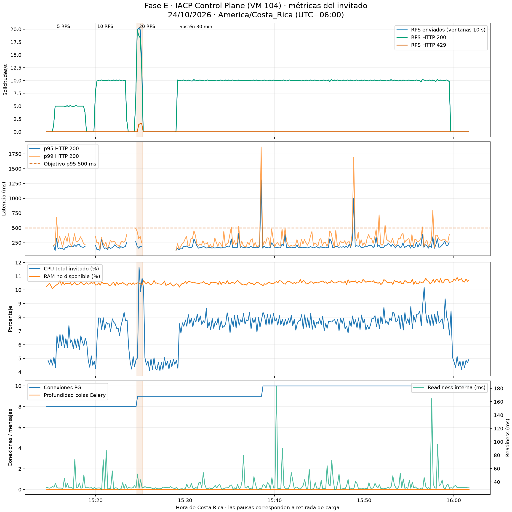
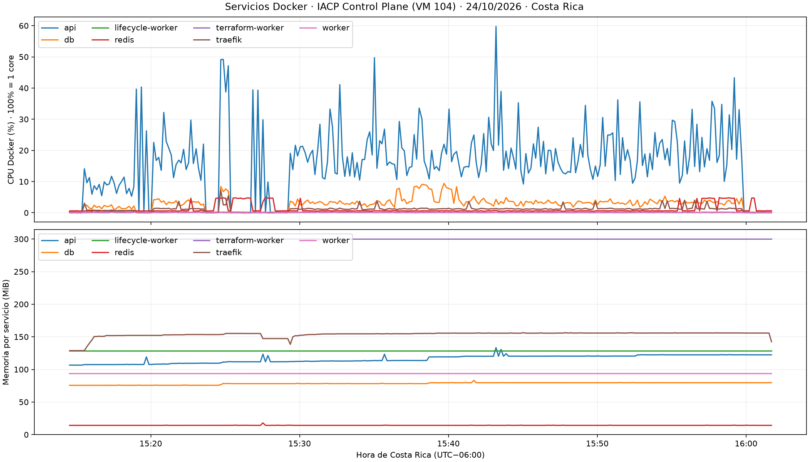

# Fase E: certificación de capacidad y resistencia del MVP

Fecha: 24/10/2026, zona `America/Costa_Rica` (UTC−06:00). Destino:
**IACP Control Plane (VM 104)**, `iacp-controlplane-01`, alojado en `mng01` del
**clúster MNG**. El clúster MNG comprende `mng01` y `mng02`; no es el Control
Plane. Platinum/PRX queda excluido. VM 104, VM 106 y Golden Image 29000
permanecen protegidas frente a mutaciones desde la API.

**GO específico de rendimiento de lectura a 10 RPS para el perfil, fuente y
configuración ensayados:** treinta minutos completos, 18.000 solicitudes,
cero errores y p95 de 190,6 ms. El primer escalón con degradación fue 20 RPS
por rechazo de admisión, sin saturación física demostrada. No se identifica
10 RPS como máximo universal del producto.

| Dictamen | Alcance |
|---|---|
| **GO de rendimiento delimitado** | Lecturas mixtas a 10 RPS, 20 usuarios, una fuente y políticas vigentes; demo conservadora a 5 RPS |
| **NO-GO a 20 RPS con esta mezcla** | 5,74% de respuestas 429; aumento detenido y niveles superiores sin ensayar |
| **GO técnico para piloto supervisado** | Se mantiene el alcance de Fase D y las cuotas del clúster MNG |
| **NO-GO de resiliencia integral** | Muerte física del worker y escenarios críticos pendientes; ninguna nueva evidencia autoriza modificarlo |

## Versión y alcance comprobados

- `origin/main` de IACP: `94cc0fbe65206a724f6b13658a64f6746b676fa3`, merge PR #49.
- Aplicación realmente ejecutada: **IACP 0.10.1 / `7c0804d`**. Los 60 archivos
  Python de la API coinciden por hash con ese commit; no solo por etiqueta.
- API/worker/Lifecycle: imagen
  `sha256:23bdc4736b06310ef74ef49dbf9332a6ced54c16fe9aab193c6a0a2d770011c5`.
- IaC Worker: imagen
  `sha256:751dd7d24532ca1f257e027a411532bb01e196340ba75f6a2fb3bc1696e7b365`.
- Esquema `0011_crm_contract`; contrato público canónico
  `5c8916b438e2d178c3fc495acd57a2edc5760e8c1bd60f33489af69c4377e3aa`.
- Siete servicios activos, sin OOM/restarts nuevos. Antes de la escalera,
  `iacpctl doctor` PASS; operaciones/applies/jobs no terminales, colas,
  unacked y advisory locks vacíos; tres workers con ping.
- Generador Locust 2.42.6 en laptop externa; ninguna carga se ejecuta en VM 104.
  El runtime no fue desplegado, reiniciado ni reconfigurado durante Fase E.

Evidencia: [código ejecutado](validation/phase-e/CODIGO_EJECUTADO.json),
[host inicial](validation/phase-e/HOST_ANTES.json),
[doctor](validation/phase-e/DOCTOR_ANTES_CARGA.json),
[dependencias previas a carga](validation/phase-e/DEPENDENCIAS_PRE_CARGA.json).
Las referencias correctas y las históricas ausentes están en
[REFERENCIAS_OPERATIVAS.json](validation/phase-e/REFERENCIAS_OPERATIVAS.json).

## E1/E2: método y escalera

El proyecto externo `iacp-load-testing` fijaba 5 RPS en configuración y variaba
usuarios en `--matrix`. Era un límite del ensayo, no un techo medido. El nuevo
perfil permite exclusivamente GET de inventario, historial/detalles, Swagger y
OpenAPI; no incluye `/power`, mutaciones, políticas, reconciliación ni creación
o eliminación de VMs. Conserva TLS, autenticación, RBAC y una sola fuente.

Método completo, pesos, comandos y guardas:
[protocolo externo](https://scm.cyberfuel.com/CyberFuel/iacp-load-testing/src/branch/main/docs/FASE_E_CAPACIDAD.md).
La escalera ensayada usa 60 s de baseline, 30 s de calentamiento y 180 s de
medición por nivel, con 60 s de retirada. Usuarios: 10/20/40/70/100 para
5/10/20/35/50 RPS. 75/100 exigirían aprobar los niveles anteriores y holgura.
Sostén: treinta minutos de medición en el último nivel estable; recuperación
final: al menos 120 s.

Los criterios estables exigen duración completa, >=95% de la tasa ofrecida,
errores <1%, p95<500 ms y p99<1.500 ms globales y por endpoint. La parada
automática combina salud, memoria/disco/CPU/conexiones, ausencia de trabajo
concurrente, errores sostenidos y latencia. No se recuperan slots perdidos con
ráfagas. Los percentiles finales se calculan de los tiempos individuales con
rango más próximo; CSV/HTML Locust conserva su histograma original.

| RPS ofrecidos | Usuarios | Ventana evaluada | Solicitudes | Errores | p50 / p95 / p99, ms | Estado |
|---:|---:|---|---:|---:|---|---|
| 5 | 10 | 180 s de medición | 900 | 0 | 85,3 / 182,5 / 274,1 | PASS |
| 10 | 20 | 180 s de medición | 1.800 | 0 | 78,0 / 179,0 / 268,2 | PASS |
| 10 sostenidos | 20 | 1.800 s de medición, más calentamiento | 18.000 | 0 | 80,7 / 190,6 / 325,4 | PASS |
| 20 | 40 | Parada a 40,009 s; observación con cierre 41,901 s | 801 | 46 HTTP 429 (5,74%) | 86,9 / 199,3 / 354,4 | FAIL de admisión; etapa incompleta |
| 35 | 70 previstos | No ejecutada tras degradación | — | — | — | BLOCKED |
| 50 | 100 previstos | No ejecutada tras degradación | — | — | — | BLOCKED |
| 75 / 100 | 150 / 200 previstos | Gate previo no aprobado | — | — | — | BLOCKED |

Los 5/10 RPS alcanzaron exactamente sus tasas durante la ventana de medición,
sin slots perdidos. En 20 RPS se enviaron 801 solicitudes durante la ventana
activa; 755 recibieron 200 y 46 recibieron 429. Los percentiles de esa fila
incluyen calentamiento y errores: **no equivalen a una etapa completa de
180 s ni a throughput exitoso de 20 RPS**. El resumen conserva también los
201 requests del tramo de medición abreviado; no se usa para declarar PASS.
En la ventana activa de esa etapa se observaron 20,02 RPS enviados y
18,87 RPS exitosos; incluyendo el cierre de usuarios, 19,12 RPS totales.
El sostén de 10 RPS tampoco perdió slots del generador.

### Punto de degradación

Primer 429: **24/10/2026 15:24:55,257 −06:00**, en GET de inventario, a
18,474 s del nivel de 20 RPS. Parada automática: **15:25:16,792 −06:00**, a
40,009 s, por errores >=1% sostenidos. No hubo 5xx ni pérdida de readiness.

El middleware vigente configura 10 RPS/ráfaga 20 **por router y fuente**, no
un techo global de 10 RPS. La mezcla cruza `iacp-crm` e `iacp-admin`.
[Configuración observada](validation/phase-e/ADMISION_TRAEFIK.json) y
[alcance explicado por Traefik](https://traefik.io/blog/how-to-keep-your-services-secure-with-traefiks-rate-limiting).
No se alteró ni se eludió. La primera degradación ensayada está en 20 RPS;
el máximo exacto entre 10 y 20 y el punto de saturación física **no quedaron
determinados**. CPU baja o respuestas 429 rápidas no acreditan capacidad
superior del backend.

## E3: observación y recuperación

Se conserva una serie cada diez segundos antes, durante y después: CPU/RAM,
swap/procesos del invitado, Docker por servicio, PostgreSQL conexiones/waits/
transacciones/scans/locks, Redis, colas/unacked/edad, jobs, operaciones/edad,
readiness interna y ping de tres workers. Fuera de carga se añade sonda HTTPS
externa para no competir en el rate limit durante el benchmark. La vista
`capacity_watch.py` lee la serie existente; no añade consultas al runtime.

Los gráficos exportados representan **el invitado VM 104**, no el hipervisor.
La interfaz Proxmox puede observarse manualmente por el usuario; no se
solicitaron ni ampliaron permisos sobre `/vms/104`. La métrica exclusiva del
hipervisor queda **no disponible** en esta entrega, por alcance autorizado.

`pg_stat_statements` no está instalado: no hay recuento exacto de sentencias
SQL por nivel. Se publican transacciones y scans con sus nombres correctos,
no como supuestas consultas. El perfil SQL dirigido es una medición separada.
No se añadió una plataforma de monitoreo ni se instalaron agentes en VM 104.
El consumo medido incluye el observador. Cada muestra registra la duración del
colector; las lecturas de Docker, host y dependencias se toman secuencialmente,
por lo que no son atómicas. La diferencia entre baseline y carga conserva ese
mismo instrumental; no se sustrae una supuesta sobrecarga de CPU no medida.

Durante el sostén, CPU del invitado: media **7,71%**, máximo **10,18%** sobre
ocho vCPU; RAM disponible mínima **89,15%**, sin swap configurado. La ausencia
de saturación del host no elimina la limitación de admisión.

| Servicio | CPU media / máxima, % de un core | RAM máxima, MiB |
|---|---:|---:|
| API | 19,55 / 59,76 | 133,40 |
| PostgreSQL | 3,69 / 9,42 | 83,14 |
| Redis | 0,96 / 4,85 | 14,49 |
| Traefik | 1,38 / 4,07 | 156,40 |
| IaC Worker | 0,10 / 0,21 | 300,00 |
| Lifecycle Worker | 0,10 / 0,20 | 128,50 |
| Worker general | 0,10 / 0,19 | 93,62 |

CPU Docker de 100% corresponde a un core; no es el porcentaje global del
invitado. Los workers estuvieron vivos y ociosos durante estas lecturas: la
tabla no acredita throughput de aprovisionamiento. El observador también
consume recursos del contenedor API.

PostgreSQL conservó 9–10 conexiones de 100, sin advisory locks, locks en
espera, deadlocks ni archivos temporales nuevos. Redis usó 1.859.000–1.889.496
bytes, sin evicciones ni rechazos de conexión; colas, unacked y edades quedaron
en cero y los tres workers respondieron. Los rollbacks de transacciones
observados no equivalen a errores HTTP: incluyen el cierre normal de sesiones
de lectura de SQLAlchemy y del observador.

**Límite de latencia visible:** 40 de 18.000 requests (0,22%) tardaron >=500 ms;
máximo 1.867,447 ms. Las ventanas locales de diez segundos iniciadas a las
15:38:30 y 15:48:50 alcanzaron p95 de 1.311,1 y 1.001,6 ms. Todas respondieron
200. No se determinó la causa; no se atribuye a CPU, PostgreSQL, red o worker.
El GO cumple los criterios agregados y por endpoint definidos antes de medir;
**no garantiza p95<500 ms en toda ventana corta**.
[Picos y muestras originales](validation/phase-e/PICOS_LATENCIA.json).

[Matriz completa](validation/phase-e/capacidad/MATRIZ_CAPACIDAD.json),
[percentiles por endpoint](validation/phase-e/RESUMEN_ENDPOINTS.md),
[estadísticas por servicio](validation/phase-e/capacidad/SERVICIOS.json),
[PostgreSQL/Redis/Celery por nivel](validation/phase-e/capacidad/DEPENDENCIAS_POR_NIVEL.json),
[recuperación](validation/phase-e/capacidad/RECUPERACION.json) y
[serie original](validation/phase-e/capacidad/metrics.jsonl). Cada directorio de
nivel conserva CSV/HTML Locust, requests individuales y un CSV derivado con
`FechaCostaRica`, además del CSV original sin cambios.

La parada HTTP de 20 RPS funcionó. El dashboard local permaneció abierto hasta
el deadline original aunque ya no enviaba carga; se corrigió su cierre y se
preservó el intervalo original sin solicitudes. El sostén usa esa corrección,
sin cambiar tasa/rutas/guardas. La recuperación interna y la primera sonda
HTTPS externa se informan separadas para no atribuir la demora del dashboard
a recuperación del producto. [Corrección y regresión antes/después](validation/phase-e/CORRECCION_GENERADOR.json).
La [integración local del cierre](validation/phase-e/CIERRE_GENERADOR_INTEGRACION.json)
usó un usuario sin HTTP: terminó en 2,474 s, con código 2 esperado, frente a
un `run-time` de 60 s, y cero solicitudes al Control Plane.

Tras retirar 20 RPS, la primera muestra interna plenamente posterior a la
última respuesta volvió al criterio de baseline en **5,744 s**, confirmado por
tres muestras a los **24,997 s**. La primera sonda HTTPS externa se tomó
175,798 s después por el cierre tardío del dashboard original, por lo que no
es un RTO mínimo del producto. Después del sostén, el retorno interno y HTTPS
se observó en **12,166 s** y se confirmó con tres muestras a los **32,510 s**.
Son cotas observadas con muestreo de diez segundos y un colector de alrededor
de cinco segundos, sin pérdida de salud ni intervención sobre servicios.

El [cierre verificado](validation/phase-e/CIERRE_VERIFICADO.json) acredita doctor
PASS, mismas imágenes y arranques, sin OOM, operaciones/applies/jobs pendientes,
colas, unacked ni advisory locks, tres workers vivos y ausencia de VMs
descartables. Los hashes de VM 106 y Golden Image 29000 se conservaron; los
cuatro states recientes observados quedaron vacíos y sin lock. Esa observación
no constituye auditoría universal de todos los objetos históricos de Wasabi.

## E4/E5: simulación y regresión física

[E4: evaluación del simulador](FASE_E_SIMULADOR.md): PASS de evaluación técnica;
no implementado ni conectado al runtime activo. El adaptador inmediato legado
no sustituye un backend con esperas/errores/eventos; un entorno futuro debe
aislar DB, Redis, procesos, red y credenciales. No hay evidencia de carga
sintética que se presente como aprovisionamiento real.

| Corrida real | Ventana local del 24/10/2026 | Recursos descartables del clúster MNG | Resultado |
|---|---|---|---|
| Individual | 15:04:48–15:07:51 | VM 30019, `mng01` | PASS automático |
| Doble | 15:08:58–15:12:53 | VM 30020 y VM 30021, `mng01` | PASS automático con reconciliación readonly de dos estados uncertain |

Se verificaron Golden Image, Cloud-Init/DHCP/QGA, SSH root con clave de host
fijada, start/reboot/shutdown y DELETE. Un Apply consumido por VM. Al final:
PostgreSQL deleted, ausencia física en Proxmox, state Wasabi vacío y sin lock.
No se borraron versiones históricas ni se forzaron desbloqueos. Cuotas vigentes,
presupuesto tres VMs y máximo dos aprovisionamientos concurrentes; IaC Worker
conservó concurrencia uno. No se solaparon E2E y escalera.

Los dos episodios `uncertain` se resolvieron sobre los mismos UUID mediante
reconciliación readonly del cliente. El diagnóstico inicial no quedó conservado
tras el éxito; **no se inventa una causa ni se acredita recuperación física del
worker**. Resumen y evidencias originales:
[E2E_REGRESION.json](validation/phase-e/E2E_REGRESION.json),
[individual](validation/phase-e/INDIVIDUAL_RESUMEN.json),
[doble](validation/phase-e/DOBLE_RESUMEN.json).
Las [conversiones locales](validation/phase-e/FECHAS_LOCALES.json) acompañan
los timestamps técnicos UTC originales sin modificar sus bytes.

## E6: factores limitantes y correcciones

1. **Admisión HTTP:** primer límite activo medido; errores 429 en 20 RPS con
   salud y recursos disponibles. Presupuestar por router/origen en el cliente;
   no ampliar políticas para aprobar un benchmark.
2. **Costo de historial CRM:** nueve SQL para hasta 50 filas, veinte para 100,
   con continuación `fulfillment` que aún consulta por creación. Candidato
   pequeño: precargar esas continuaciones, preservando payload y tenant.
3. **Serialización del IaC Worker:** concurrencia uno, cola de 8,261 s en el
   segundo flujo del doble y tiempos distintos del individual. No atribuir
   toda la diferencia al scheduler: coexistieron reconciliaciones readonly.

Solo el primero es una saturación de admisión observada; no se inventan tres
servicios físicamente saturados. Las lecturas físicas dirigidas de Proxmox
costaron 164,9–202,2 ms y tres GET por observación; quedaron fuera de Locust.
Las propuestas pequeñas, sus comparativas y regresiones necesarias están en
[FASE_E_CORRECCIONES_PROPUESTAS.md](FASE_E_CORRECCIONES_PROPUESTAS.md).
El “después” de cambios de API/worker queda pendiente: no se presenta una
mejora no implementada como resultado. La única corrección aplicada fue al
cierre del dashboard del cliente externo, con prueba que falla antes y pasa
después; la suite pasó de 44 a 45 pruebas.

## Límites conservados y demo del 27/10/2026

- La normalización de Compose, directorios y credenciales queda fuera de esta
  fase; se documentan referencias activas e históricas para resolverla después
  del MVP. DB/Redis/Traefik conservan su configuración y volúmenes.
- La rotación planificada de tokens permanece diferida después del MVP, con
  riesgo registrado y sin declaración de seguridad aprobada. No bloqueó estas
  pruebas independientes; no se cambiaron tokens, ACL ni identidades.
- El ensayo físico de muerte del worker sigue **BLOCKED por aislamiento
  insuficiente**. La retirada de carga no lo sustituye.
- Para la demo, revalidar versión, peer TLS, salud, colas/locks y política
  aprobada vigente. La política usada vence el 24/10/2026 a las **16:46:00
  de Costa Rica**; no acredita autorización el día 27. Usar el procedimiento
  existente de aprobación independiente, sin ampliar cuotas.
- Presupuesto conservador de demo: 5 RPS agregados para dejar margen a UI y
  polling; un E2E individual y luego doble, con máximo dos flujos y recursos
  descartables del clúster MNG. Separar la demostración Locust de mutaciones.

El dictamen de **GO para piloto supervisado** y el **NO-GO de resiliencia
integral** se mantienen independientes del cierre de rendimiento.
