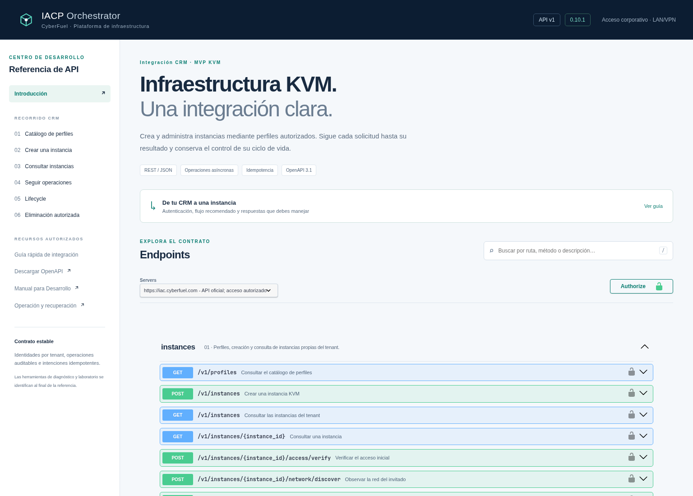
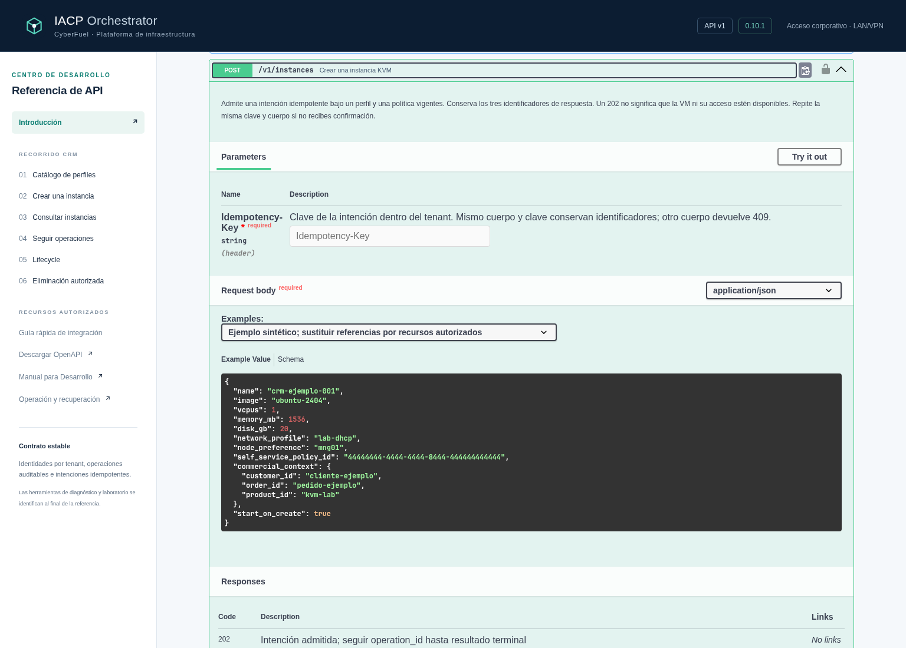

# Fase F1/F2: documentación profesional para Desarrollo

Fecha: 24/10/2026, zona `America/Costa_Rica` (UTC−06:00).
Destino de la auditoría: **IACP Control Plane (VM 104)**, alojado en `mng01`
del **clúster MNG**. Base Forgejo: `c332b5c`, con Fase E fusionada; aplicación
observada: IACP 0.10.1 / `7c0804d`. El cliente externo contiene el merge del
PR #7 en `74c7e70`. No se reinterpretan resultados de Fase E.

## Resultado y alcance

El candidato moderniza exclusivamente la presentación de Swagger y sus
anotaciones editoriales. **Conserva el contrato HTTP de las 26 operaciones**:
schemas, campos, tipos, defaults, required, operationIds, cabeceras, códigos,
seguridad e idempotencia. No modifica handlers de negocio, `/v1`, DB, motor,
módulos, providers, Golden Image, Compose, rutas operativas o credenciales.

El snapshot efectivamente servido antes del cambio está en
[OPENAPI_ANTES.json](validation/phase-f/swagger/OPENAPI_ANTES.json); el candidato
congelado en [OPENAPI_CANDIDATO.json](validation/phase-f/swagger/OPENAPI_CANDIDATO.json).
El [diff contractual](validation/phase-f/swagger/DIFF_CONTRACTUAL.json) compara
la estructura HTTP y conserva los modelos íntegros. Las anotaciones editoriales
no son un cambio del contrato de ejecución.

## Presentación y recorrido CRM

- Título IACP Orchestrator y versión 0.10.1 visibles; identidad propia sobria
  de CyberFuel y favicon SVG creado para este repositorio.
- Marco corporativo oscuro y contenido Swagger claro. Se conserva el contraste
  nativo de formularios y código, sin forzar un tema oscuro no oficial.
- Navegación según perfiles → creación → inventario → operaciones → Lifecycle
  → eliminación autorizada; catálogo primero dentro del grupo de instancias.
- Búsqueda local por ruta, método y texto, con recuento y atajo `/`.
- Summaries y descriptions en español, ejemplos sintéticos validados contra los
  schemas y guía rápida con estados, respuestas, cabeceras e idempotencia.
- Diagnóstico y laboratorio se identifican después del recorrido CRM. Los
  endpoints administrativos conservan su esquema separado y su RBAC.
- Enlaces al manual de integración y operación de Forgejo; la autorización
  de Forgejo es independiente de la identidad Basic de documentación.

La documentación comercial no presenta motores internos. No se copió interfaz
ni funcionalidad de WAHA. Los identificadores y direcciones de ejemplo son
sintéticos; no autorizan recursos ni representan una ejecución real.

## Assets y autenticación

Swagger UI **5.34.0**, fijado a paquete, integridad SHA-512 y hashes por archivo.
Se conservan LICENSE y NOTICE Apache-2.0 en `app/iacp/static/swagger/5.34.0/`.
La procedencia está en su `PROVENIENCIA.json`. CSS/JS, favicon e identidad de
IACP son locales. El validador externo se deshabilita y no hay dependencia CDN.

Los recursos se resuelven con una lista cerrada mediante el parámetro `asset`
de las rutas **existentes** `/docs` y `/admin/docs`. No se añade un endpoint
ni un árbol estático sin autenticación. Un recurso desconocido devuelve 404
después de verificar identidad; no acepta rutas de filesystem del cliente.

Se conservan `authorize_docs` y `authorize_admin_docs` sin cambios: Basic para
documentación y Bearer para API, con ámbitos independientes. Las credenciales
no se preautorizan ni persisten; `persistAuthorization=false`. Se conserva
`Cache-Control: no-store` y el resto del middleware HTTP.

## Pruebas y límites de evidencia

Validación dirigida inicial: 156 pruebas aprobadas. Regresión final: **892
pruebas aprobadas, cero fallos/omisiones**, 143,52 s; PostgreSQL 17 y Redis 7
locales descartables. [Registro de pruebas](validation/phase-f/swagger/PRUEBAS.json). La prueba de
supervisión requirió declarar `PYTHONPATH=/workspace/app` en la **imagen de
pruebas**, para que su subprocess importe el mismo código; no se cambia el
supervisor ni se presenta como certificación física del worker.

El [navegador aislado](validation/phase-f/swagger/NAVEGADOR_CANDIDATO.json)
comprobó 26 operaciones, búsqueda por endpoint, escritorio/móvil, cero accesos
externos, cero errores JavaScript y ausencia de desbordamiento móvil. Utiliza
SQLite y credenciales sintéticas, sin acceso de infraestructura ni workers
reales. Sus capturas **son del candidato local, no de VM 104**.





La auditoría HTTPS previa desde la laptop LAN/VPN confirmó docs, OpenAPI,
esquema administrativo autorizado y readiness. El runtime previo dependía de
CDN y del favicon predeterminado. Esta validación previa no acredita que el
candidato esté desplegado. Cualquier promoción debe utilizar `iacpctl` y
`go_live.py`, manifiesto revisado y evidencias actuales, sin sustituir
automáticamente el runtime por una imagen OCI recién publicada.

## Verificación reproducible

```sh
bash scripts/test-integration.sh
python3 scripts/openapi_contract.py \
  docs/validation/phase-f/swagger/OPENAPI_ANTES.json docs/openapi.json
```

La guía de integración existente está en
[handbook/API_INTEGRATION.md](handbook/API_INTEGRATION.md). La guía interactiva
de Swagger conserva Basic y explica que se necesita Bearer para ejecutar la
API. El operador debe comprobar una política vigente antes del ensayo real.

Fuentes: [configuración oficial de Swagger UI](https://swagger.io/docs/open-source-tools/swagger-ui/usage/configuration/)
y [OpenAPI 3.1](https://swagger.io/specification/v3.1/).
