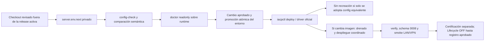

# Operación canónica de IACP

La normalización e03807d/0006 ya fue ejecutada. Esta rama incorpora 0007 para DELETE y 0008 para perfiles DHCP,
con flags OFF; no se aplicó en VM 104. Ver [piloto y DELETE](SAFE_DELETE.md).

La normalización es global a IACP; `deploy/mng` representa el primer entorno de
validación, no un algoritmo ligado a un clúster. Las asignaciones Proxmox siguen
fuera de Git. Base inspeccionada: `60da261f901b609b042c742b74fe5903f272715f`.
La entrada operativa es **scripts/iacpctl**, con paths absolutos, proyecto fijo
`iacp-controlplane`, un Compose y `/etc/iacp/server.env` como fuente activa de
variables no secretas/referencias, modo 0600. Ningún comando imprime config cruda.

## Ejecución LAB API-first

En el **IACP Control Plane (VM 104)** del clúster **MNG**, el archivo privado
`/etc/iacp/execution-profile.json` puede declarar exclusivamente el perfil
`environment=lab`, `cluster=MNG`, `control_plane=VM104`, el hostname local y
`enabled=true`. Debe ser un archivo regular propiedad de root, sin permisos de
grupo u otros, y los comandos deben ejecutarse con la identidad efectiva del
operador autorizado del sistema operativo. Su ausencia conserva el camino de
producción; un perfil inválido falla cerrado. Un header, argumento o variable
del cliente nunca selecciona LAB.

Con ese perfil, `deploy`, `promote-env`, `migrate-technical-ownership` y
`recover-queued-guest-init` generan evidencia local con actor, fecha, SHA,
acción y resultado, sin exigir un `change_record` vencible por cada operación.
El preflight, la comparación estricta de Compose, los digests, locks, colas,
`check_idle`, exclusión de escritores y doctor permanecen obligatorios. En
producción `go_live.py` conserva la validación de actor, referencia, aprobación
y ventana UTC.

La recuperación administrativa de Guest Initialization está disponible en
`POST /v1/instances/{instance_id}/provisioning/guest-initialization/recover`.
Solo cancela una tarea `queued` que nunca consumió `guest-exec`, con ownership y
tenant válidos, bajo locks exclusivos y con Redis/Celery inactivos. La acción es
atómica e idempotente, conserva la auditoría y convierte una entrega tardía en
no-op; una operación ya consumida falla cerrado. VM 104, VM 106 y las Golden
Images 29000, 29001, 29010 y 29011 continúan protegidas.



## Inventario comprobado y directorios

El runtime usaba ocho archivos en `/opt/iacp/releases/controlplane-v1`, más
`/etc/iacp/changes/traefik-lan-ports.override.yaml` en Traefik. DB/Redis conservan
etiquetas del bootstrap `/opt/iacp/stacks/controlplane/compose.yaml`. La comparación
lee las etiquetas `com.docker.compose.project.config_files` y environment_file,
renderiza el Compose efectivo en memoria privada y contrasta también bindings,
variables y networks de los objetos Docker reales: editar server.env no puede
reescribir retroactivamente la configuración ejecutada.

| Directorio/archivo | Uso |
|---|---|
| deploy/mng/compose.yaml | Única definición de producción; nueve servicios, sin extends ni build implícito |
| deploy/mng/server.env.example | Template sin secretos, imágenes, rutas o CIDRs operativos precargados |
| /etc/iacp/server.env | Fuente activa 0600; conserva referencias actuales |
| /etc/iacp/changes/server.env.next | Staging 0600; no se usa automáticamente |
| /etc/iacp/changes/manifest-normalization.json | Release, imágenes, revisiones y aprobaciones del driver; referencia el Compose canónico y env activo |
| /etc/iacp/identity | tenant_credentials.json, approver.token; nunca copiar tokens/hashes a Git |
| /etc/iacp/lifecycle | kvm_credentials.json dedicado, sin credencial Terraform |
| /etc/iacp/terraform | credentials.json, allocations.json y claves SSH protegidas |
| /etc/iacp/tls/certs | fullchain.pem, privkey.pem corporativos |
| /etc/iacp/tls/dynamic | iacp.yml revisado; CIDR temporal no equivale a aprobación |
| /opt/iacp/backups | Respaldos DB/config privados; restore primero aislado |
| /opt/iacp/evidence | Informes privados del driver; diagnósticos y backups de identidad no se publican |

Los archivos db_password y api_token observados continúan en el directorio de
secretos del bootstrap. Se preservan sus referencias actuales; moverlos a
/etc/iacp sería otro cambio explícito, no parte de esta adopción. No se modifican
imágenes, volúmenes, networks ni artefactos históricos para resolver errores.

| Servicio | Imagen | Puerto host | Datos/mounts | Networks/config |
|---|---|---|---|---|
| api | controlplane-api:IACP_RELEASE | ninguno | DB/API/tenant/KVM secrets, sin state | backend/frontend/egress; flags explícitos |
| worker | misma API | ninguno | DB/API secrets | backend/egress, celery, concurrency=1 |
| terraform-worker | IACP_TF_WORKER_IMAGE | ninguno | fuente/allocations readonly, planes RW, DB/TF secrets | backend/egress, root readonly, caps ALL drop, no-new-privileges |
| lifecycle-worker | misma API | ninguno | solo DB/KVM secrets; sin fuente/state/TF | backend/egress, readonly, lifecycle queue, concurrency=1 |
| traefik | digest aprobado | IP privada :80/:443 | TLS/static/dynamic readonly | frontend/proxy_network; sin dashboard/socket/8080 host |
| db | postgres:17-alpine existente | ninguno | postgres_data externo, db_password | backend interno, pg_isready |
| redis | redis:7-alpine existente | ninguno | redis_data externo, AOF | backend interno, ping |
| migrate | misma API | ninguno | DB secret | backend; one-shot Alembic head |
| ownership-certifier | imagen TF | ninguno | planes readonly, fuente/allocations readonly, DB/TF/KVM secrets | perfil certification, readonly; workspace exec privado efímero |

Los nombres externos postgres_data, redis_data y terraform_plans se resuelven del
env a los volúmenes existentes, no se crean sustitutos. Los workers no tienen
healthcheck Docker en la release inspeccionada: `status` distingue running de
healthy; `doctor` verifica sus respuestas/colas Celery. API, DB y Redis deben ser
healthy. No se agrega un falso estado healthy a roles sin healthcheck.

## Adopción y comando único de despliegue

Preparar el checkout del PR en `/opt/iacp/releases/iacp-normalization`, fuera de la
release activa. No commitear ni ejecutar git reset en el checkout operativo.
Conservar imágenes existentes para adoptar solo configuración; para habilitar
credenciales docs-only, construir/revisar una imagen que incluya este PR sin
sobrescribir el tag 60da261. Registrar ambos commits y los IDs reales en el cambio.

En server.env.next agregar `IACP_TRAEFIK_CONFIG_DIR` apuntando al directorio
estático existente verificado, y preservar TODAS las variables activas, incluidos
Apply=1, Admission=0 y Lifecycle=0. No usar el candidato anterior a ciegas: el
candidato observado carecía de Admission=0. El template es una referencia, no
reemplaza el inventario. Mantener IACP_TLS_BIND_IP en la IP privada autorizada.

En el manifest revisado fijar runtime_dir al nuevo checkout y:

```json
{"configuration_mode":"canonical","compose_files":["deploy/mng/compose.yaml"],"environment_file":"/etc/iacp/server.env","configuration_changes":[]}
```

Con imágenes nuevas se admiten **solo** rutas `/services/<rol>/image` explícitas
en configuration_changes, para api/worker/terraform-worker/lifecycle-worker/migrate/
ownership-certifier. No se admite ignorar cambios en DB, puertos, secretos,
volúmenes, networks o flags. Los cambios de imágenes además requieren los pins,
IDs y ventana del driver. El único delta funcional de configuración aceptado
siempre es TMPDIR/tmpfs del certificador inactivo; build metadata deja de aplicarse
en producción. Los informes enumeran rutas de diferencias sin valores sensibles.

```sh
export CTL=/opt/iacp/releases/iacp-normalization/scripts/iacpctl
# Preparación y lectura, independiente del cwd:
sudo "$CTL" --env-file /etc/iacp/changes/server.env.next config-check
sudo "$CTL" --env-file /etc/iacp/changes/server.env.next \
  --manifest /etc/iacp/changes/manifest-normalization-candidate.json \
  --evidence-dir /opt/iacp/evidence/normalization-candidate-doctor doctor
```

El manifest de candidato señala ese env de staging; no se inventan aprobaciones.
Tras aprobar comparación y ventana, el manifest activo referencia environment_candidate
(path/sha256 reales) y una acción promote-env. Promover con backup privado y
reemplazo atómico, sin tocar contenedores:

```sh
sudo "$CTL" --manifest /etc/iacp/changes/manifest-normalization.json \
  --evidence-dir /opt/iacp/evidence/normalization-env \
  env-promote --candidate /etc/iacp/changes/server.env.next
```

**Único comando de despliegue en VM 104, después de preparar/aprobar lo anterior:**

```sh
sudo /opt/iacp/releases/iacp-normalization/scripts/iacpctl --manifest /etc/iacp/changes/manifest-normalization.json --evidence-dir /opt/iacp/evidence/normalization-deploy deploy
```

Deploy delega al driver oficial, exige acción deploy vigente y compara con runtime
antes de parar nada. Si esquema coincide con el head de la release e imágenes son ya las aprobadas, adopta la
entrada canónica con verify sin reiniciar contenedores. Con imágenes nuevas usa
el drenado y despliegue coordinado existente, con una interrupción de admisión
planificada; no se promete cero downtime para una actualización binaria de una
sola API. No toca DB/Redis/Traefik ni usa down -v, remove-orphans o force-recreate
masivo. Flags, datos e historia se verifican. No deshabilita Apply.

Conservar el override externo y los scripts /root históricos hasta comprobar
configuración canónica, bindings, doctor y smoke. Después archivarlos mediante
cambio aprobado; esta implementación no los borra. Las etiquetas de DB/Redis
pueden seguir indicando bootstrap: no se recrean solo para cambiar metadata.

## Swagger: origen, acceso y rotación

Origen **real comprobado**: username Basic `iacp` está fijo en security.py; la
contraseña legacy es un token IACP válido: api_token del bootstrap o un token
con digest en tenant_credentials.json. No hay htpasswd de Traefik ni password
recuperable desde un hash. La API usa Bearer opaco por tenant/rol, **no JWT**.
La prueba LAN real con TLS válido dio ready 200, docs/OpenAPI 401 anónimo y
200 autorizado, sin imprimir el token.

Este PR incorpora rol `docs` en el registro existente. Con una identidad docs
configurada, Basic acepta únicamente su username/password; ya no usa el token API
como password de navegador. El token docs se rechaza en /v1 incluso como Bearer.
Las llamadas Bearer de automatización a docs siguen sujetas a tenant/rol existentes.
El login de Swagger y Authorize HTTPBearer son credenciales de alcances distintos.

Generar contraseña aleatoria de alta entropía y candidato sin modificar el registro
activo. El comando solo imprime rutas, jamás password/hash:

```sh
sudo "$CTL" docs-rotate --registry /etc/iacp/identity/tenant_credentials.json \
  --tenant UUID_DEL_TENANT_ACTIVO --username iacp-docs-operator \
  --handoff-dir /etc/iacp/identity/handoff-CAMBIO
```

Entregar operator-handoff.json (0600, directorio 0700) por el gestor corporativo
o copia SSH autorizada al operador; no chat, email, logs ni Git. registry.next.json
preserva exactamente las credenciales API y solo rota la identidad docs. Se ha
preparado un handoff local privado para este encargo, sin activarlo en producción.

Primero desplegar la imagen de este PR conservando el registro antiguo; una imagen
60da261 no entiende el rol docs. Después, con acción rotate-docs aprobada y nueva
API verificada, instalar el candidato y remontar **solo API**:

```sh
sudo "$CTL" --manifest /etc/iacp/changes/manifest-normalization.json \
  --evidence-dir /opt/iacp/evidence/docs-rotation docs-install \
  --candidate /etc/iacp/identity/handoff-CAMBIO/registry.next.json
```

Se valida el candidato con el modelo del proceso API actual antes de tocarlo,
se conserva backup 0600 y propietario/modo, y se instala atómicamente. La
recreación API explícita es necesaria porque un bind de archivo mantiene su inode
antiguo tras replace; no se reinician workers/DB/proxy. Usar ventana autorizada.
Verificar 401/200 tras el cambio. Si falla, restaurar el backup de identidad
privado en la misma ventana y remontar únicamente API; nunca restaurar la DB.
El navegador puede cachear Basic: usar un contexto nuevo al rotar. En Authorize
usar un token reader/operator/approver del tenant, nunca el password docs.

## Certificador, diagnóstico y demo

Evento 063 reproducido: `ownership.plan`, comando Terraform show, exit=1, provider
bpg no ejecutable bajo /tmp noexec. No fue un fallo TLS ni de permisos SQL. La
corrección mantiene /tmp noexec y agrega solamente al certificador un tmpfs exec
privado UID10001, nosuid/nodev, 512 MiB, con TMPDIR dirigido allí. Sigue con root
readonly y planes readonly. El replay corregido sobre VM 106 pasó readonly:
validated=true, recorded=false, no-op, provider 0.116.1/CLI1.16.6, state invariado.
No se modifica source_revision histórico ni se hace Apply/Import/Destroy.

```sh
sudo "$CTL" --manifest /etc/iacp/changes/manifest-normalization.json \
  --evidence-dir /opt/iacp/evidence/normalization-certify certify
# SOLO con record-certificate aprobado y controles/evidencia revisados:
sudo "$CTL" --manifest /etc/iacp/changes/manifest-normalization.json \
  --evidence-dir /opt/iacp/evidence/normalization-record certify --record
sudo "$CTL" status
sudo "$CTL" logs api --tail 100
```

No se registró el certificado: la autorización observada solo contiene deploy y
validate-certificate, no record-certificate, y tiene ventana acotada. No fabricar
otra aprobación. Lifecycle y admisión permanecen OFF; VM 106 no se inicia.

Demo completa bloqueada de forma verificable antes de crear recursos: no existe
DELETE en el contrato de e03807d; esta rama lo implementa OFF. Admission/Lifecycle OFF; la asignación disponible
es la VM 106 histórica, no una VM demo descartable autorizada. DHCP no está
implementado: Allocation exige ipv4_cidr/gateway estáticos aprobados. No inventar
/stop o /delete. Los endpoints existentes son create/read, power/start y
power/shutdown. Una demo futura requiere otra asignación/VMID/nombre/IP aprobados,
aprobación/Apply separados, certificación y eliminación API revisada. El checker
readonly `scripts/demo_preflight.py` consulta OpenAPI autenticado, registra tiempos
y lista vacía de operation_ids, y se detiene antes de cualquier POST si falta CRUD.
No se borra VM 106 ni se crean huérfanos para demostrar una demo parcial.

Desde laptop LAN/VPN, sin Docker local, ejecutar el mismo probe mediante la entrada:

```sh
/path/al/checkout/scripts/iacpctl --manifest /ruta/manifest-corporativo.json smoke -- \
  --lan-vpn-vantage --vantage-id LAPTOP-AUTORIZADA --token-file /ruta/reader.token \
  --output /ruta/smoke-lan.json
```

Con gateway añadir Cookie privada; con CA privada añadir --ca-file. Nunca -k.
El CIDR 192.168.0.0/20 observado es temporal y no prueba aprobación de Seguridad.
La ausencia de NAT/WAN requiere la revisión real del perímetro, no se deduce de
una IP privada o un probe local. TLS se renueva por PKI corporativa/DNS-01 con
fullchain y clave privados, misma ruta y nuevo smoke; no otro reverse proxy.

## Backup, recuperación y límites

Mantener backup PostgreSQL/restore aislado ya acreditados; no repetirlos para
normalizar ni restaurar sobre la DB viva para resolver auth/provider. Conservar
snapshots/Version ID/hashes de Wasabi y los volúmenes existentes. Recuperar tareas
por operation_id y misma clave; uncertain sin UPID requiere investigación, no SQL.

Rollback funcional, explícito y aprobado, sin schema downgrade:

```sh
sudo "$CTL" --manifest /etc/iacp/changes/manifest-normalization.json \
  --evidence-dir /opt/iacp/evidence/normalization-rollback rollback
```

Mantiene el head aplicado y Apply=1; cierra admisión/Lifecycle, conserva certificados y observa
UPID conocidos. No rollback de esquema, state resets, comandos qm manuales o
restauración de DB. Para fallos de configuración, restaurar el backup de env en
una ventana y verificar comparación antes de aplicar; las imágenes compatibles
con el head aplicado y la propiedad started se preservan.

Pruebas locales/diagnósticos readonly reales se registran en
[OPERATIONAL_NORMALIZATION.json](validation/OPERATIONAL_NORMALIZATION.json). CI
requiere un runner desechable con label iacp-disposable-validation, nunca VM 104;
el workflow se entrega pero no se declara ejecutado en Forgejo sin ese runner.

## Perfiles DHCP y piloto API

Ver [DHCP_PILOT](DHCP_PILOT.md) para Swagger/CRM, payloads reales, rutas de parámetros, fuente Terraform, migraciones 0007/0008 y recuperación. `IACP_TF_PROFILES_PATH` referencia `/etc/iacp/terraform/profiles.json` (0440 root:10001), montado readonly únicamente en API y Terraform Worker. Lifecycle no recibe perfiles, IPAM, credenciales Terraform ni claves SSH.
