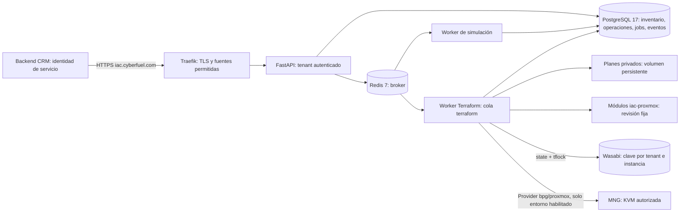

# Arquitectura y flujo de ejecución

IACP conserva el flujo FastAPI → Redis → Celery → PostgreSQL del bootstrap.
La API valida y registra intención; el worker ejecuta fuera de la petición HTTP.
La simulación es el valor predeterminado. El worker Terraform es un servicio
optativo, aislado del proceso FastAPI, con acceso de salida acotado al entorno.

La API no recibe comandos, argumentos Terraform, VMID, nodo, credenciales, state
key o tenant arbitrarios. `InstanceCreate` contiene nombre, imagen lógica y
recursos. `IACP_INSTANCE_EXECUTOR` selecciona el backend en el servidor; la
asignación externa resuelve los parámetros de infraestructura autorizados.

El proceso de creación registra atómicamente Instance, Operation, Job, evento y,
para Terraform, Execution/Attempt. Después publica la cola. El plan fija
asignación, VMID reservado, revisión de módulo, variables, backend y SHA-256 del
binario. Un tenant inactivo o una cancelación detiene el intento.

El plan admite solo create/no-op de
`module.kvm.proxmox_virtual_environment_vm.this`. No admite adopción de recursos
ajenos, modificaciones, reemplazos ni destrucción. El módulo se extrae mediante
`git archive` de una revisión fija, no se ejecuta el checkout mutable. La versión
actual utiliza Terraform 1.16.6 y provider bpg/proxmox 0.116.1, con lockfile readonly.
La lógica HCL y el tamaño configurable del disco siguen en `iac-proxmox`.

La aplicación tiene dos controles independientes: habilitación explícita del
entorno y autorización persistente de una identidad approver. La autorización
está ligada al intento y hash del plan, caduca y se consume una sola vez. El
operador que solicita apply debe ser distinto del aprobador. El worker vuelve a
validar el vínculo justo antes de iniciar la mutación.

La exclusión combina lock de sesión PostgreSQL por instancia, reserva única de
VMID, claim persistente de run y locking S3 de Terraform. Una entrega repetida de
Celery no reclama un run ya iniciado. Una caída posterior al inicio de apply
produce un resultado incierto; la recuperación observa el provider y nunca
repite apply automáticamente.

Tras apply, `plan -refresh-only` consulta el provider; se registra únicamente una
proyección permitida de VMID, nodo, nombre, CPU, RAM, disco, datastore y encendido.
La lectura de encendido corresponde al comportamiento de
[vmReadCustom del provider 0.116.1](https://github.com/bpg/terraform-provider-proxmox/blob/v0.116.1/proxmoxtf/resource/vm/vm.go#L4195).
No se persiste el JSON completo del state ni la salida de diagnóstico. `ready`
confirma una KVM observada con recursos esperados; no certifica salud del invitado.

Persistencia y límites de confianza:

| Componente | Persistencia | Exposición |
|---|---|---|
| PostgreSQL | Volumen existente, migraciones 0001–0004, sin downgrade destructivo | Red backend interna, sin puerto publicado |
| Redis | AOF y volumen existente; no es fuente del inventario | Red backend, sin puerto publicado |
| API | Estado en PostgreSQL, secretos externos | Solo Traefik; sin puerto de host |
| Worker | Jobs y autorización en PostgreSQL | Sin puertos; egress requiere política externa |
| Planes | Volumen externo por entorno, directorios 700 y archivos privados | Worker Terraform y operadores autorizados |
| Wasabi | Backend existente, clave estable por instancia y versiones del objeto | TLS, identidad específica y prefijo autorizado |
| Certificados | Directorio externo de solo lectura para Traefik | Claves fuera de Git y de las imágenes |

La red `proxy_network` incorpora únicamente Traefik; la API mantiene frontend y
backend. La pertenencia a redes Docker es un límite administrativo, no aislamiento
frente a un administrador del host. El listener HTTP de transición se publica en
loopback. El acceso de CRM y LAN debe validarse desde los orígenes efectivos.
