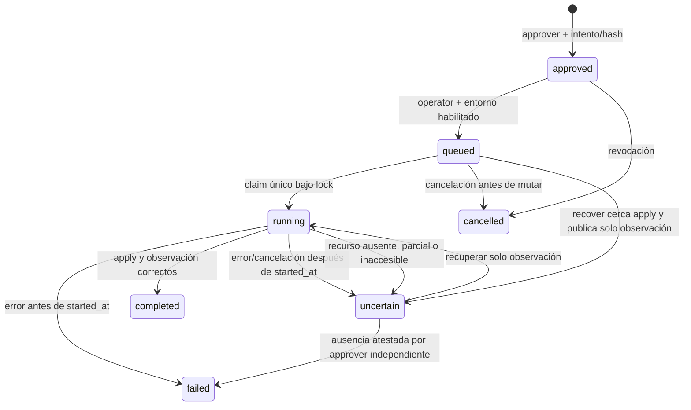

# Estados, idempotencia y errores

La API mantiene `detail` como cadena para los errores de dominio y autenticación.
Los errores de validación 422 conservan la estructura estándar FastAPI (`detail`
como lista con ubicación/tipo). OpenAPI documenta ambas formas. X-Request-ID se
incluye en las respuestas HTTP de la aplicación. Los IDs de operación, job e
instancia permiten correlacionar consultas y eventos; no se deben registrar tokens.

## Estados persistidos

| Entidad | Estados | Significado |
|---|---|---|
| Job | queued, running, completed, failed | Una unidad de cola; el job plan completed no equivale a KVM lista |
| Operation | queued, running, completed, failed | Intención de creación; running mientras espera aplicación aprobada |
| Instance | pending, provisioning, ready, failed | Inventario; ready simulado y ready real se distinguen explícitamente |
| TerraformExecution | queued, running, planned, failed, cancelled | Planificación; planned permanece como evidencia aun después de aplicar |
| TerraformAttempt | queued/running/planned/failed/cancelled/interrupted | Historial de intentos de plan, sin crear otra instancia ni state |
| TerraformApply | approved, queued, running, completed, failed, uncertain, cancelled | Autorización y ejecución de un plan exacto |

La caducidad se valida al encolar y antes de mutar; una aprobación no inicia un
apply por sí sola. Un run running tras caída solo se observa mediante recover.
No existe reintento automático de apply ni transición de uncertain a un apply nuevo.
`result.observed_at` corresponde a una observación puntual, no a monitoreo continuo.

## Claves idempotentes

| Operación | Alcance / vínculo | Repetición idéntica | Conflicto |
|---|---|---|---|
| Crear instancia | Tenant + Idempotency-Key + hash del cuerpo normalizado | Mismos IDs; no republica, incluso si falló | Otro cuerpo: 409 |
| Reintentar plan | Instancia + clave retry + expected_attempt | Mismo número de intento | Otro intento o worker activo: 409 |
| Aprobar plan | Instancia + clave aprobación + cuerpo + aprobador | Misma autorización y vigencia original | Otro cuerpo/sujeto o plan ya autorizado: 409 |
| Solicitar apply | Autorización + clave dispatch + solicitante | Mismo run/job y estado actual; no republica | Otra clave/sujeto: 409 |
| Recuperar apply | Mismo run persistido | Solo observación; cerca apply incluso en queued | Estado terminal o worker activo: 409 |
| Resolver ausencia | Autorización + clave + cuerpo + aprobador independiente | Mismo cierre failed; un solo evento | Evidencia, clave o sujeto distintos: 409; cuerpo inválido: 422 |

Las claves tienen 1–128 caracteres `[A-Za-z0-9._:-]`. Deben ser estables por intención
del CRM y conservarse tras timeout. La respuesta idempotente refleja el estado
persistido actual, no necesariamente una copia byte a byte de la primera respuesta.
No existen retención/expiración automáticas de claves ni limpieza de inventario.

## Respuestas HTTP

| HTTP | Causa | Acción del consumidor |
|---|---|---|
| 200 | Consulta o cancelación procesada | Interpretar entidad y estado |
| 201 | Autorización creada o recuperada por clave | Conservar approval_id; todavía no ejecuta infraestructura |
| 202 | Intención/job registrado | Consultar IDs; no asumir terminación |
| 401 | Token ausente/inválido | Corregir identidad, sin reintento masivo |
| 403 | Rol insuficiente o tenant inactivo | Solicitar revisión administrativa |
| 404 | Objeto inexistente o de otro tenant | No inferir existencia fuera del tenant |
| 409 | Conflicto de idempotencia, estado o autorización | Consultar estado; no cambiar clave para forzar duplicados |
| 422 | Cuerpo/header inválido | Corregir contrato; no llega al worker |
| 503 | Autenticación/configuración/DB/cola no disponible o ejecución deshabilitada | Conservar intención; consultar/repetir misma clave cuando corresponda |

Un 403/404 del proxy por origen no autorizado puede tener cuerpo de Traefik,
distinto del error FastAPI. Un fallo del provider es asíncrono: la creación HTTP
puede haber sido 202 y el job terminar failed/uncertain.

## Códigos de dominio y ejecución

| Código | Implicación | Recuperación |
|---|---|---|
| APPLY_DISABLED / REAL_PLAN_DISABLED | Entorno no habilitado | No forzar; requiere aprobación de configuración |
| AUTHORIZED_CONFIGURATION_REQUIRED / CREDENTIALS_REQUIRED / CA_CERTIFICATE_REQUIRED | Falta asignación, secreto o confianza TLS | Corregir configuración externa autorizada |
| INDEPENDENT_APPROVAL_REQUIRED | Sujeto no independiente | Usar identidad revisora autorizada distinta |
| APPROVAL_EXPIRED_OR_CONSUMED / PLAN_ALREADY_AUTHORIZED | Autorización no reutilizable | Consultar/cancelar; nuevo intento y aprobación si no hubo mutación |
| PLAN_CHANGED / PLAN_INTEGRITY_FAILED / SOURCE_REVISION_CHANGED | Vínculo o artefacto distinto | Detener y revisar; no sustituir el plan aprobado |
| IDEMPOTENCY_CONFLICT | Clave/sujeto/cuerpo no coinciden | Recuperar la intención original |
| VMID_ALREADY_RESERVED | VMID reservado por otra instancia | Corregir asignación con Infraestructura; no elegir otro automáticamente |
| CONTROLPLANE_PROTECTED / UNOWNED_STATE / UNSAFE_PLAN | VM 104, recursos ajenos o cambios fuera de política | Detener e investigar; nunca aprobar ese plan |
| TERRAFORM_VERSION_MISMATCH / SOURCE_UNAVAILABLE | Versión o revisión no disponible | Restaurar build/source fijados |
| TERRAFORM_TIMEOUT / EXECUTION_DEADLINE_EXCEEDED / OUTPUT_LIMIT_EXCEEDED | Límite de proceso o flujo | Revisar started_at; después de mutar exige conciliación |
| TERRAFORM_COMMAND_FAILED / TERRAFORM_EXECUTION_FAILED | Fallo sin exponer diagnóstico sensible | Inspección privada; no reaplicar a ciegas |
| INVALID_PLAN_OUTPUT / INVALID_TERRAFORM_OUTPUT / OBSERVED_RESOURCE_MISMATCH | Resultado inválido o distinto de la asignación | Mantener incertidumbre y revisar provider/state |
| RESOURCE_ABSENT | Observación sin recurso administrado | No crear automáticamente; verificar state y Proxmox |
| RESOURCE_ABSENCE_CONFIRMED | Cierre auditado failed por ausencia en ambas fuentes | No reaplicar autorización consumida; futura decisión exige intento y aprobación nuevos |
| ABSENCE_NOT_CONFIRMED / INVALID_ABSENCE_EVIDENCE | Falta conciliación verificada o evidencia temporal válida | Conservar uncertain; completar revisión independiente |
| CANCELLED / TENANT_INACTIVE | Cancelación o suspensión del tenant | Antes de mutar: revisar; después: conciliar |
| DISPATCH_FAILED / DISPATCH_UNCONFIRMED | Publicación fallida/ambigua | Consultar IDs; recuperar mismo run sin duplicar intención |
| APPLY_REQUIRES_RECONCILIATION / RECONCILIATION_REQUIRED | Replan bloqueado por autorización/ejecución | Cancelar antes de mutación o conciliar después |
| RECOVERY_NOT_REQUIRED / APPLY_ALREADY_COMPLETED | Acción incompatible con estado actual | Consultar resultado existente |

El catálogo se complementa con los mensajes legacy conservados, como
`Unauthorized`, `Authentication unavailable`, `Tenant unavailable`,
`Write permission required`, `Instance not found`, `Job not found` y
`Persistence unavailable`. Los textos legacy de conflicto no deben parsearse como
identificadores nuevos; usar HTTP y la entidad persistida para decidir.
